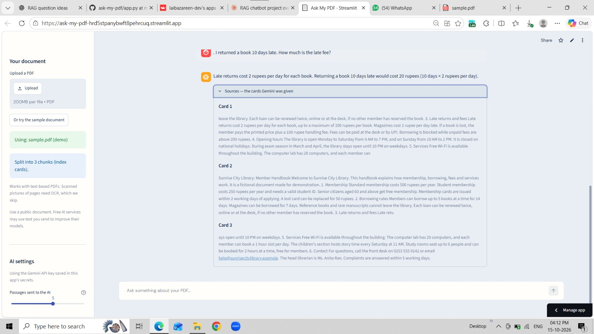
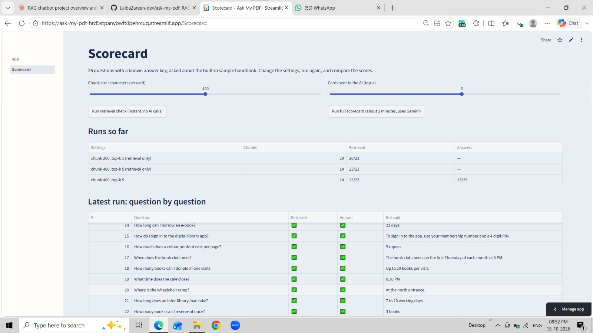
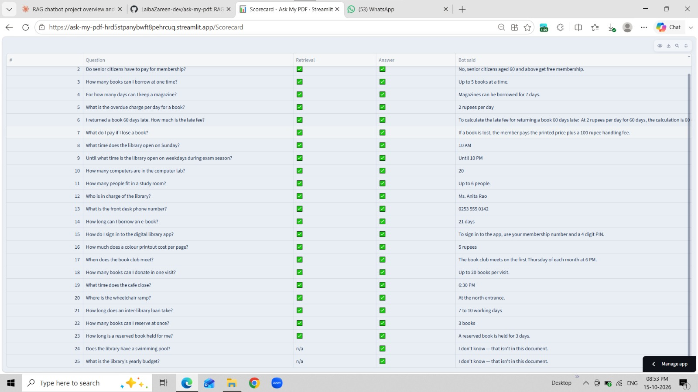

# Ask My PDF: RAG Chatbot with an Evaluation Scorecard

Ask questions about a PDF in plain English and get answers grounded in the document, with the source passages shown. Includes a built-in **scorecard** that tests the bot on 25 questions with a known answer key.

**Live demo:** https://ask-my-pdf-hrd5stpanybwft8pehrcuq.streamlit.app
(Click "Or try the sample document" in the sidebar. No PDF needed. If the app is asleep, click the wake-up button and wait a minute.)

## Screenshots




## How it works

1. **Load:** the PDF text is extracted with `pypdf`.
2. **Chunk:** the text is cut into overlapping passages (never mid-word).
3. **Index:** each passage is converted to TF-IDF vectors (character n-grams, so "resource" matches "resources").
4. **Retrieve:** the question is scored against every passage; the top-k closest are selected.
5. **Generate:** Gemini answers using only those passages, and replies "I don't know" if the answer isn't there.
6. **Show sources:** the passages used are displayed under every answer so it can be verified.

Built from scratch in plain Python (no LangChain), so every step is visible in the code.

## Evaluation

The **Scorecard** page runs 25 questions against the sample handbook and scores two things separately:

- **Retrieval:** did the search hand the AI the passage that contains the answer?
- **Answer:** did the final answer contain the correct fact? (A keyword check against the answer key in `eval_set.py`.)

Two of the 25 questions are deliberately unanswerable, to test that the bot says "I don't know" instead of guessing. Retrieval is therefore scored on the other 23.

| Setting | Retrieval (of 23) | Answers (of 25) |
|---|---|---|
| Baseline: chunk 200, top-k 1 | 20 | not run |
| Tuned: chunk 400, top-k 5 | 23 | 25 |

The questions include reworded versions of facts (for example "overdue charge" for "late fee") and a calculation with a cap.

## Limitations (what I found)

- **The test set is small and self-written** (25 questions on a short handbook I wrote), so these scores show the pipeline works, not that it is 100% accurate on every document.
- **Questions that need the whole document fail.** On a 15-page roadmap PDF, "share all the resource links" returned about half of the links, because only the top-k passages reach the AI. RAG suits focused questions, not "list everything".
- **Search is keyword-based (TF-IDF), not semantic.** It handles plurals and wording changes, but may miss a question phrased with entirely different words than the PDF.
- Scanned (image-only) PDFs are not supported.
- The Gemini free tier has rate limits, so the full scorecard takes about 2 minutes.

## Design decisions

- **TF-IDF instead of a neural embedding model:** no model download, instant start-up, and it fits free hosting memory. Semantic embeddings are a planned upgrade.
- **Retrieval and answers scored separately,** so a failure can be traced to the search or to the AI.
- **API key kept in Streamlit secrets,** never in the code.

## Run it yourself

```bash
git clone https://github.com/laibazareen-dev/ask-my-pdf.git
cd ask-my-pdf
pip install -r requirements.txt
mkdir -p .streamlit
echo 'GEMINI_API_KEY = "your-key"' > .streamlit/secrets.toml
streamlit run app.py
```

## Project structure

```
app.py              chat page (UI, upload, chat)
rag_core.py         extract, chunk, index, retrieve, ask Gemini
eval_set.py         the 25 questions and answer key
pages/Scorecard.py  runs the evaluation
sample.pdf          fictional library handbook used for the demo and scorecard
```

## Next improvements

- Semantic embeddings, or a hybrid of keyword + semantic search
- A larger test set written independently of the document
- Multi-document support and page-number citations

**Stack:** Python, Streamlit, pypdf, scikit-learn, Google Gemini API
